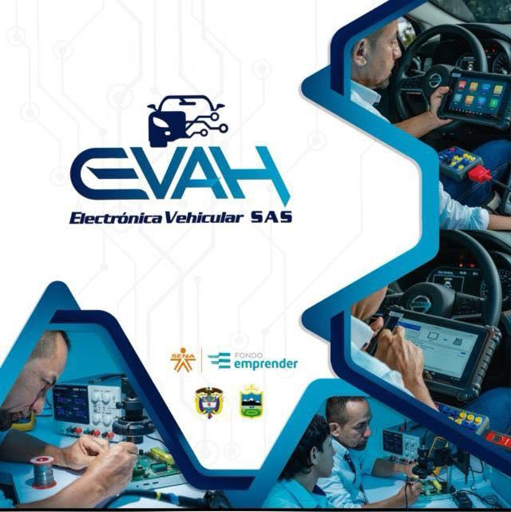

# EVAH – Electrónica Vehicular



**Sistema web para la gestión de servicios electrónicos vehiculares.**

EVAH es una aplicación web desarrollada para apoyar la gestión de un negocio dedicado al mantenimiento, diagnóstico y reparación de sistemas eléctricos y electrónicos de vehículos. El proyecto ha evolucionado desde una página web informativa hasta un sistema con backend, conexión a base de datos y funcionalidades para administrar la información del negocio.

## 1. Descripción del proyecto

El sistema EVAH permite gestionar información relacionada con los servicios ofrecidos, los usuarios y las facturas generadas. Cuenta con una interfaz web y un backend desarrollado con NestJS, conectado a una base de datos PostgreSQL.

El objetivo es centralizar la información y facilitar los procesos administrativos del negocio mediante una plataforma organizada y funcional.

## 2. Objetivos

### Objetivo general

Desarrollar una aplicación web para la gestión de servicios electrónicos vehiculares, integrando una interfaz de usuario, un servidor backend y una base de datos relacional.

### Objetivos específicos

- Diseñar una interfaz web intuitiva y organizada.
- Permitir el registro y consulta de servicios.
- Gestionar la información de los usuarios.
- Registrar y consultar facturas.
- Conectar el backend con una base de datos PostgreSQL.
- Implementar operaciones de comunicación entre el frontend y el backend mediante una API REST.

## 3. Funcionalidades implementadas

### Página web

- Interfaz gráfica de EVAH.
- Presentación de la empresa y sus servicios.
- Secciones informativas y de navegación.
- Panel de administración para gestionar información del negocio.

### Gestión de servicios

- Registrar nuevos servicios.
- Consultar los servicios almacenados.
- Guardar información como nombre, descripción y precio.

### Gestión de usuarios

- Registrar usuarios.
- Consultar usuarios registrados.
- Almacenar información como nombre, correo, teléfono y rol.
- Incorporar una ruta para el inicio de sesión.

### Gestión de facturación

- Registrar facturas.
- Consultar las facturas almacenadas.
- Consultar una factura por su identificador.
- Actualizar el estado de una factura.
- Eliminar facturas.

### Backend y API REST

El backend permite conectar la página web con la base de datos y procesar las solicitudes realizadas desde el frontend.

Se implementaron rutas HTTP para realizar operaciones como:

| Método | Ruta | Función |
|---|---|---|
| GET | `/servicios` | Consultar servicios |
| POST | `/servicios` | Registrar servicios |
| GET | `/usuarios` | Consultar usuarios |
| POST | `/usuarios` | Registrar usuarios |
| POST | `/usuarios/login` | Iniciar sesión |
| GET | `/facturas` | Consultar facturas |
| POST | `/facturas` | Registrar facturas |
| GET | `/facturas/:id` | Consultar una factura |
| PATCH | `/facturas/:id/estado` | Actualizar estado |
| DELETE | `/facturas/:id` | Eliminar factura |

## 4. Tecnologías utilizadas

| Tecnología | Aplicación en el proyecto |
|---|---|
| HTML5 | Estructura de la página web |
| CSS3 | Diseño y estilos de la interfaz |
| JavaScript | Funcionalidades e interacción |
| Node.js | Entorno de ejecución del backend |
| NestJS | Desarrollo de la API REST |
| TypeScript | Lenguaje utilizado en el backend |
| PostgreSQL | Sistema de gestión de base de datos |
| TypeORM | Conexión y gestión de entidades de la base de datos |
| Git | Control de versiones |
| GitHub | Almacenamiento y seguimiento del proyecto |
| Docker | Herramienta de configuración y ejecución de contenedores del proyecto |

## 5. Arquitectura del proyecto

El proyecto utiliza una arquitectura dividida en tres partes principales:

1. **Frontend:** interfaz web con la que interactúa el usuario.
2. **Backend:** aplicación NestJS que recibe las solicitudes, ejecuta la lógica del sistema y se comunica con la base de datos.
3. **Base de datos:** PostgreSQL, donde se almacena la información de servicios, usuarios y facturas.

## 6. Estructura del proyecto

```text
Proyectogit_Tovar_Caviedes/
│
├── backend/
│   ├── src/
│   │   ├── servicios/
│   │   ├── usuarios/
│   │   ├── facturas/
│   │   ├── app.module.ts
│   │   └── main.ts
│   │
│   ├── public/
│   │   └── index.html
│   │
│   ├── .env.example
│   └── package.json
│
├── img/
├── index.html
├── style.css
├── script.js
├── Dockerfile
├── docker-compose.yml
├── .gitignore
└── README.md
```

## 7. Instalación y ejecución

### Requisitos

- Node.js y npm.
- PostgreSQL.
- Visual Studio Code.
- Git (opcional, para clonar el repositorio).

### Clonar el repositorio

```bash
git clone https://github.com/tovarmiguel1201-tech/Proyectogit_Tovar_Caviedes.git
```

Ingresar a la carpeta del backend:

```bash
cd Proyectogit_Tovar_Caviedes/backend
```

Instalar las dependencias:

```bash
npm install
```

Configurar las variables de entorno en el archivo `.env`, utilizando como referencia `.env.example`.

Iniciar el servidor:

```bash
npm run start:dev
```

El backend se ejecuta normalmente en:

```text
http://localhost:3000
```

### Consultar la API

Las siguientes rutas permiten comprobar la comunicación con el backend:

- http://localhost:3000/servicios
- http://localhost:3000/usuarios
- http://localhost:3000/facturas

Para abrir la página web desde Visual Studio Code, se puede utilizar la extensión Live Server.

## 8. Base de datos

El sistema utiliza PostgreSQL como motor de base de datos y TypeORM para gestionar la comunicación entre NestJS y las entidades.

La información se organiza en módulos que permiten administrar:

- Servicios.
- Usuarios.
- Facturas.

Las credenciales de conexión se configuran mediante variables de entorno y no deben publicarse en el repositorio.

## 9. Equipo de desarrollo

**Desarrolladores:**

- Miguel Tovar.
- David Caviedes.

**Proyecto académico:** Electrónica Vehicular EVAH.

## 10. Repositorio

El código fuente y los avances del proyecto se encuentran disponibles en GitHub:

https://github.com/tovarmiguel1201-tech/Proyectogit_Tovar_Caviedes

---

**EVAH – Electrónica Vehicular**

Sistema web orientado a la gestión y administración de servicios electrónicos vehiculares.